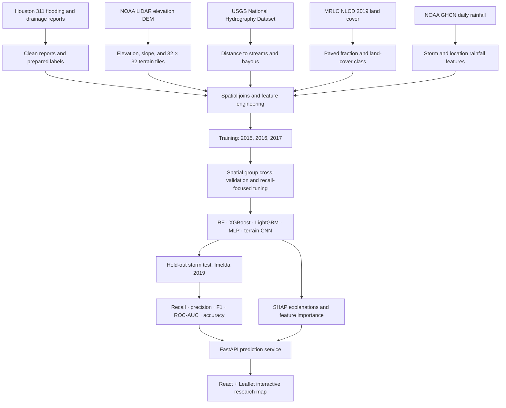

# Spatio-Temporal Urban Flood Hotspot Prediction

### Multi-Source Geospatial Data Engineering and Explainable Deep Learning — Houston, Texas

University of Houston · COSC 6368 Artificial Intelligence · Fall 2026 · Three-person team

> **Research prototype, not an official flood warning.** Predictions must not be used as a substitute for emergency alerts, engineering assessments, insurance decisions, or official flood maps.

This project aims to estimate whether a Houston location is a flood hotspot from historical storm reports and environmental/geospatial features, return a flood probability, and explain the prediction. The planned interactive map will let users explore locations and hypothetical rainfall scenarios.

**Project status:** Source datasets, prepared train/test tables, photographs, and the course presentation are currently in the repository. Geospatial enrichment, model training, SHAP analysis, and the web application are planned work; no model scores or application capabilities are claimed here until implemented and evaluated.

## Contents

- [Project overview](#project-overview)
- [Project flow](#project-flow)
- [Visuals](#visuals)
- [Data and provenance](#data-and-provenance)
- [Feature plan](#feature-plan)
- [Model and validation plan](#model-and-validation-plan)
- [Explainability plan](#explainability-plan)
- [Planned application](#planned-application)
- [Repository contents](#repository-contents)
- [Setup and current limitations](#setup-and-current-limitations)
- [Evaluation and results](#evaluation-and-results)
- [Team and course](#team-and-course)
- [References](#references)

## Project overview

### Research question

Can historical Houston 311 flooding reports and multi-source terrain, drainage, land-cover, and rainfall data help identify locations associated with flooding in a storm that was not used for training?

### Intended output

For a supported Houston location and scenario, the system is intended to provide:

1. A probability estimate for the project’s operational flood-hotspot label.
2. A configurable classification threshold, selected with flood recall in mind.
3. A location-level explanation showing which available features influenced that estimate.
4. A clear reminder that the prototype is not an official warning or a calibrated measure of an individual resident’s flood probability.

The label is based on the available report-derived dataset. It should not be interpreted as a verified record of every flood or as a measure of flood depth, duration, or property-level risk.

## Project flow

The diagram distinguishes the intended workflow from completed work. The final test set is reserved for the 2019 Imelda storm; model and preprocessing choices should be made using training data and spatial validation only.



## Visuals

The photographs below are contextual project assets, not model inputs and not geolocated evidence of a specific prediction. Please preserve the original source/creator attribution when the image licensing permits it; the filenames alone do not establish image licenses.

<table>
	<tr>
		<td align="center"><br>Hurricane Harvey (2017)</td>
		<td align="center"><br>Memorial Day storm (2015)</td>
		<td align="center"><br>Tropical Storm Imelda (2019)</td>
	</tr>
</table>

**Presentation:** [FloodProject-V4-Presentation.pptx](assets/presentation/FloodProject-V4-Presentation.pptx)

**Planned result figures:** Add validation and test-set plots here after running the full pipeline. Suggested figures: spatial fold map, storm-year report counts, ROC/precision-recall curves, confusion matrix at the selected threshold, model comparison, and SHAP global/local explanations. Do not publish illustrative or training-only scores as held-out results.

## Data and provenance

| Source | Intended use | Project status |
|---|---|---|
| City of Houston 311 flooding/drainage reports | Historical report locations and flood labels | CSV files are included for 2015, 2016, 2017, and 2019 |
| NOAA Office for Coastal Management, Texas DEMs | Elevation, slope, terrain patches | Local raster is at `data/raw/noaa/TX_North2_GCS_3m_NAVDm.tif`; it is not tracked in Git (see [large-file note](#large-raster-not-in-git)) |
| USGS National Map / National Hydrography Dataset (NHD) | Streams/bayous and distance features | Download and processing planned |
| Multi-Resolution Land Characteristics Consortium (MRLC), NLCD 2019 | Land-cover class and impervious/paved proxy | Download and processing planned |
| NOAA NCEI, GHCN-Daily | Rainfall features | Download, station selection, and interpolation planned |

### Prepared tables

The project description reports the following dataset sizes and split; verify them against the current CSVs when rebuilding the pipeline:

| File | Reported rows | Period | Intended role |
|---|---:|---|---|
| `data/processed/flood_training_set.csv` | 85,738 | 2015, 2016, 2017 storms | Model development and spatial cross-validation |
| `data/processed/flood_test_set.csv` | 24,852 | Tropical Storm Imelda, 2019 | Final held-out-storm evaluation |

The project description reports a balanced 50/50 label distribution in each table. Because this is a constructed/balanced dataset, its predicted probabilities may not reflect real-world flood prevalence without additional calibration and representative sampling. Report the sampling procedure, missing-report limitations, duplicate handling, and label definition in the final report.

### Original report data

- `data/raw/city_of_houston/floodingdrainage2015.csv`
- `data/raw/city_of_houston/floodingdrainage2016.csv`
- `data/raw/city_of_houston/floodingdrainage2017.csv`
- `data/raw/city_of_houston/floodingdrainage2019.csv`

Before combining public sources, document each download date, license/usage terms, spatial reference system, temporal coverage, and any filtering or transformation. Never infer that a location did not flood solely because no 311 report exists there.

## Feature plan

The prepared tables are described as containing these columns:

| Feature | Meaning / planned source | Current status per project notes |
|---|---|---|
| `year`, `storm_name`, `storm_date` | Event/time context | Present |
| `lat`, `lon` | Report/sample coordinates | Present |
| `weight` | Existing sampling or record weight; meaning needs documentation | Present; definition to verify |
| `elevation_m` | DEM elevation at the point | Empty; derive from DEM |
| `slope_degrees` | Terrain gradient near the point | Empty; derive from DEM |
| `distance_to_bayou_m` | Distance to nearest selected stream/bayou | Empty; derive from NHD geometry |
| `paved_pct` | Impervious/paved surface proxy | Empty; derive from NLCD and document class mapping |
| `land_cover_type` | Land-cover class | Empty; derive from NLCD |
| `rainfall_inches` | Storm-associated rainfall feature | Empty; derive from documented gauge/time-window method |
| `flooded` | Project target label (0/1) | Present; definition and provenance must be documented |

Feature generation must use consistent coordinate systems, units, nodata handling, raster bounds, date windows, and point-to-grid rules. Fit any learned preprocessing only on the training folds to avoid leakage.

## Model and validation plan

Planned model families:

1. Random Forest (scikit-learn)
2. XGBoost
3. LightGBM
4. Multi-Layer Perceptron (MLP) on the feature table
5. Convolutional Neural Network (CNN) on 32 × 32 elevation patches, optionally combined with tabular features if designed and validated explicitly

### Split and fairness checks

- **Development:** 2015–2017 storms only.
- **Spatial cross-validation:** group nearby locations into geographic blocks and keep each block entirely within one fold. Define and report the block scheme; random row splits are not a substitute.
- **Final temporal/storm test:** Tropical Storm Imelda 2019 only; do not use it for feature selection, threshold tuning, preprocessing fit, or hyperparameter selection.
- **Spatial and storm leakage:** inspect repeated/near-duplicate coordinates, event identifiers, and sampling weights. Report whether the training/validation groups or storm metadata can act as shortcuts.

Tune the decision threshold and model selection to emphasize flood recall, using spatial validation—not the final Imelda test. A high-recall threshold may increase false alarms, so present precision and the confusion matrix alongside recall.

### Metrics to report

- Flood-class recall (primary; state the positive class and selected threshold)
- Precision and F1 score
- ROC-AUC (and preferably precision-recall AUC for the balanced/constructed sample)
- Accuracy and confusion matrix
- Mean and variability across spatial folds
- Held-out Imelda metrics once, after the pipeline is fixed
- Calibration analysis if probabilities are presented as probabilities

The project proposal cites an approximately 80% accuracy and 83–89% flood-recall benchmark from Liu, Felton, and Mostafavi (2024). Verify the full citation and compare only if target definition, sampling, evaluation split, and metrics are sufficiently comparable. This is a reference benchmark, not a result achieved by this project.

## Explainability plan

Planned SHAP approaches:

- Random Forest, XGBoost, LightGBM: tree explainers where supported by the model/version.
- MLP and CNN: a compatible gradient-based explainer or a carefully bounded model-agnostic explainer with a representative background set.
- Global: summarize feature contributions across an explicitly identified evaluation sample.
- Local: explain an individual prediction with signed contributions and the model’s baseline/output space.

An explanation such as “low elevation increased the model score” describes model behavior, not proof of causation. For CNNs, image attribution and tabular SHAP values answer different questions; document the input and output being explained. Do not invent percentages for feature contributions or describe them as percentages of flood risk unless the SHAP output has been correctly transformed and labeled.

## Planned application

**Backend:** FastAPI prediction API. **Frontend:** React. **Map:** Leaflet (or Mapbox if selected and configured). Intended interactions:

- Enter a Houston address or choose a map location.
- View a research-model score and its uncertainty/limitations.
- Inspect local explanation factors available for that location.
- Adjust a 1–20 inch rainfall scenario slider and see scenario predictions update.
- Compare a hypothetical heavy-rain scenario with the model’s supported input range.

Geocoding, rainfall scenario construction, map coverage, and model feature availability must be implemented and documented before these interactions are described as working. Scenario predictions are not forecasts.

## Repository contents

### Shared project layout

```text
.
├── README.md                         # Project overview, workflow, methods, status
├── assets/
│   ├── images/                       # Contextual storm photographs
│   └── presentation/                 # Course presentation
├── data/
│   ├── raw/
│   │   ├── city_of_houston/          # Original annual flooding/drainage CSVs
│   │   ├── noaa/                     # DEM (large, local-only; excluded from Git)
│   │   ├── usgs/                     # Planned NHD downloads
│   │   ├── mrlc/                     # Planned NLCD downloads
│   │   └── noaa_rainfall/            # Planned GHCN data
│   └── processed/                    # Prepared train/test tables
├── notebooks/                        # Shared analysis notebooks
├── src/                              # Shared reusable Python code
├── app/                              # Planned backend/frontend application
└── team/
	├── marvin/                       # Marvin's notes and experiments
	├── aaliyah/                      # Aaliyah's notes and experiments
	└── sakina/                       # Sakina's notes and experiments
```

The directory guide files are present; the shared code pipeline and app are still planned work. Do not duplicate shared datasets in `team/`.

### Branches and collaboration

The shared `main` branch is the integration baseline. Each teammate has an individual branch—`marvin`, `aaliyah`, and `sakina`—and a corresponding `team/<name>/` workspace. Start work on your branch, commit your changes there, then open a pull request into `main` so shared code and data changes can be reviewed. Keep each teammate's branch updated from `main`; avoid direct commits to `main` for individual work.

Use the personal folders for scratch notes and experiments. Reusable code belongs in shared `src/`, `notebooks/`, or `app/` paths via a reviewed pull request. The team's task assignments are not yet specified; agree on ownership and record it in each member README rather than assuming roles.

Clone the repository once, then switch to your branch:

```bash
git clone https://github.com/sakina-saifuddin/Spatio-Temporal-Urban-Flood-Hotspot-Prediction-with-Multi-Source-Geospatial-Data-Engineering-.git
cd Spatio-Temporal-Urban-Flood-Hotspot-Prediction-with-Multi-Source-Geospatial-Data-Engineering-
git switch marvin   # or: git switch aaliyah / git switch sakina
```

To bring reviewed shared work into your branch, run `git switch main`, `git pull`, then `git switch <your-branch>` and `git merge main`. Push your branch and open a pull request when your change is ready.

### Planned project organization

```text
flood_project/
├── data/
│   ├── raw/                 # Original source data by provider
│   └── processed/           # flood_training_set.csv and flood_test_set.csv
├── tiles/
│   ├── train/
│   └── test/
├── notebooks/
│   ├── 01_data_engineering.ipynb
│   ├── 02_eda.ipynb
│   ├── 03_model_training.ipynb
│   └── 04_shap_explainability.ipynb
├── src/
│   ├── data_engineering.py
│   ├── tile_generator.py
│   ├── models.py
│   ├── train.py
│   ├── evaluate.py
│   └── shap_analysis.py
├── app/
│   ├── backend/
│   └── frontend/
├── team/
│   ├── marvin/
│   ├── aaliyah/
│   └── sakina/
└── requirements.txt
```

The tree above is the target pipeline organization, not a claim that those scripts already exist. Generated tiles, model weights, and raw downloads should have documented reproducible generation steps and should not be committed if they exceed repository limits.

## Setup and current limitations

No executable pipeline or dependency manifest is included yet. When the pipeline is implemented, document a reproducible environment and exact commands here. Planned Python libraries include pandas, NumPy, GeoPandas, Rasterio, Shapely, scikit-learn, XGBoost, LightGBM, PyTorch, SHAP, FastAPI, Uvicorn, Matplotlib, Seaborn, SciPy, and MLflow. Install only the dependencies needed by each component and record tested versions.

### Large raster not in Git

`data/raw/noaa/TX_North2_GCS_3m_NAVDm.tif` is approximately 4.2 GB. It is intentionally excluded by `.gitignore` because it exceeds GitHub’s 100 MB per-file limit. It remains on the original local machine, but is **not available to other repository users**. Obtain the NOAA source independently or place the raster in an approved external storage/data repository and document its URL, checksum, license, and download instructions. Do not commit generated copies of this raster or large tile collections.

Raw data may have third-party licensing or redistribution restrictions. Check the terms for each source before sharing data, derived files, or photographs publicly.

## Evaluation and results

**Results are pending.** No model has been trained or evaluated in the current repository state. Do not treat the reported benchmark above as a project result.

Complete this table only with measured, reproducible results. Specify the spatial validation design, selected threshold, positive class, and test sample for every metric. Keep the 2019 test set untouched until final evaluation.

| Model | Spatial CV flood recall (mean ± SD) | Spatial CV precision | Spatial CV F1 | Imelda 2019 recall | Imelda 2019 precision | ROC-AUC | Threshold |
|---|---:|---:|---:|---:|---:|---:|---:|
| Random Forest | Pending | Pending | Pending | Pending | Pending | Pending | Pending |
| XGBoost | Pending | Pending | Pending | Pending | Pending | Pending | Pending |
| LightGBM | Pending | Pending | Pending | Pending | Pending | Pending | Pending |
| MLP | Pending | Pending | Pending | Pending | Pending | Pending | Pending |
| Terrain CNN | Pending | Pending | Pending | Pending | Pending | Pending | Pending |

Add figures and per-location explanations after results have been generated from the saved evaluation pipeline. Include model/data versions and the exact commit or configuration used to produce them.

## Team and course

- **Course:** COSC 6368 — Artificial Intelligence
- **Institution:** University of Houston
- **Term:** Fall 2026
- **Team:** Three-person university project
- **Proposal report due:** October 26, 2026
- **Final presentation:** November 30, 2026

Add team-member names, roles, and contact details here only with their consent.

## References

- NOAA Office for Coastal Management, [Digital Coast elevation data](https://coast.noaa.gov/slrdata/DEMs/TX/index.html).
- USGS, [The National Map Downloader](https://apps.nationalmap.gov/downloader/) and National Hydrography Dataset.
- Multi-Resolution Land Characteristics Consortium, [NLCD and MRLC viewer](https://www.mrlc.gov/viewer).
- NOAA National Centers for Environmental Information, [Climate Data Online](https://www.ncei.noaa.gov/cdo-web/) and GHCN-Daily.
- City of Houston, [311 service requests and flooding/drainage information](https://www.houstontx.gov/heatmaps).
- Liu, Felton, and Mostafavi (2024): full bibliographic citation and source URL to be added after verification; the proposal’s benchmark attribution is not yet independently documented here.

## Acknowledgments

This project uses publicly available datasets and is intended for educational research. Add exact dataset citations, image creator credits, and applicable license notices as the team verifies each source.
