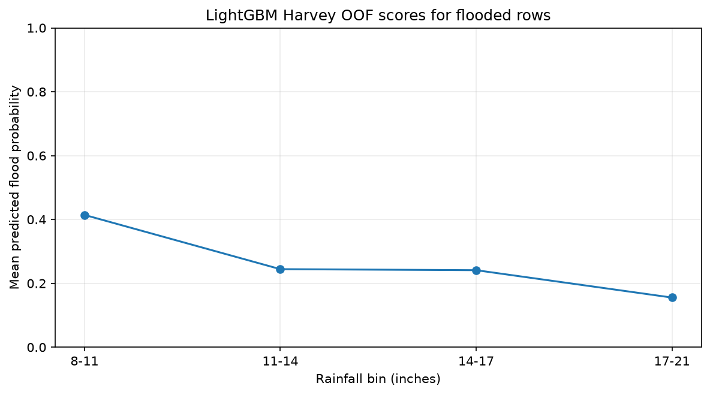
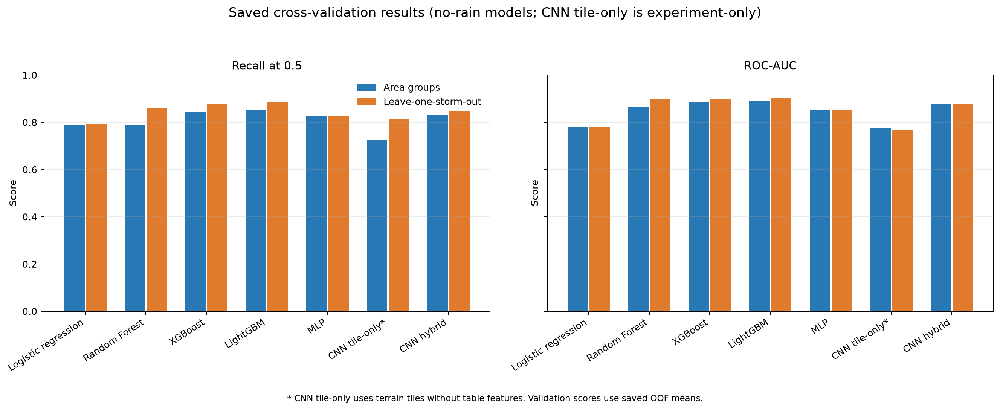
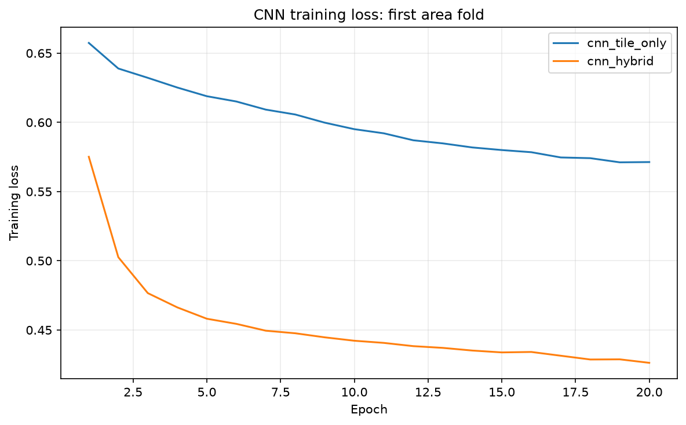
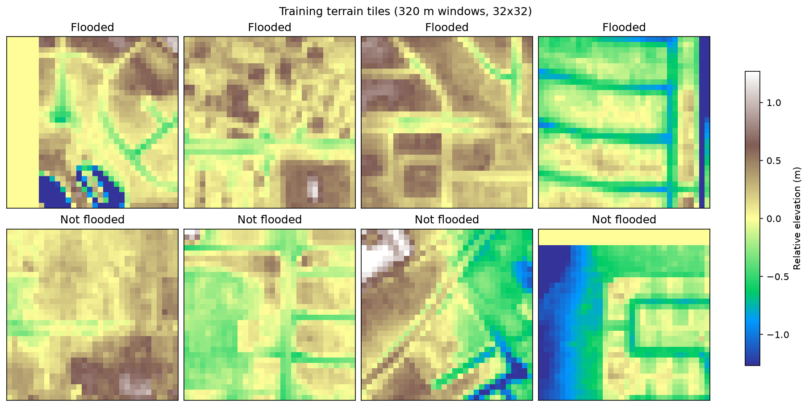
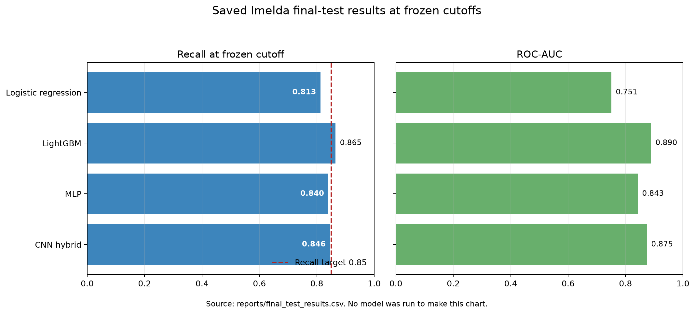
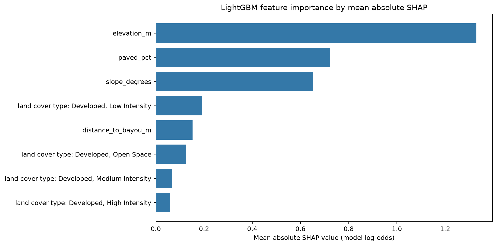
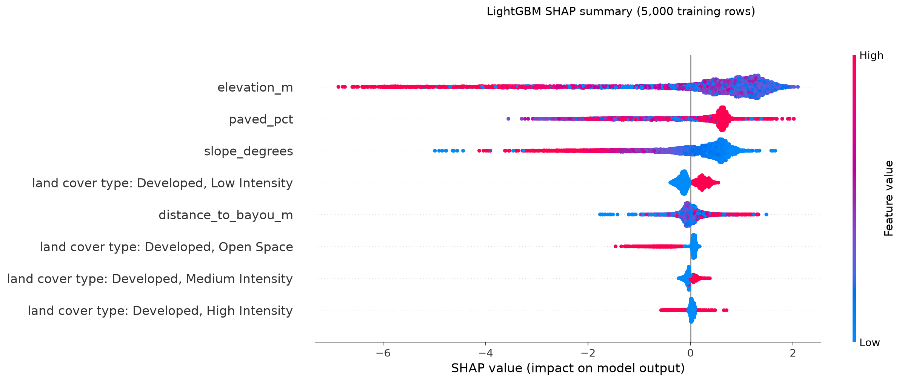
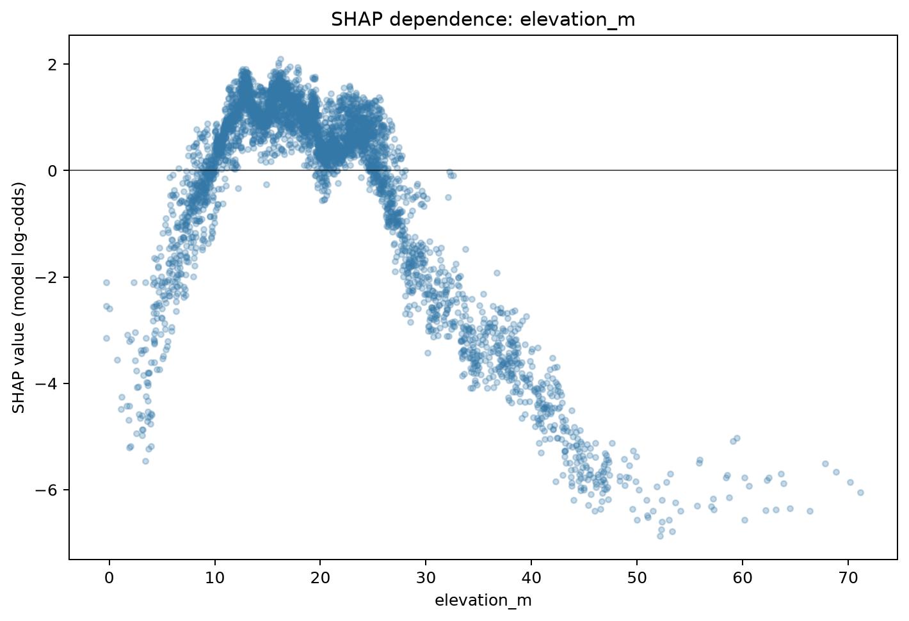
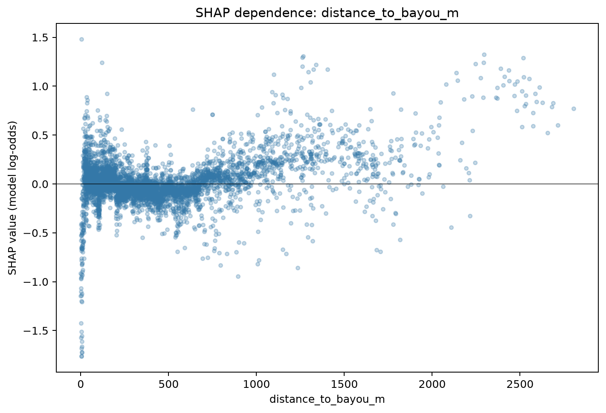
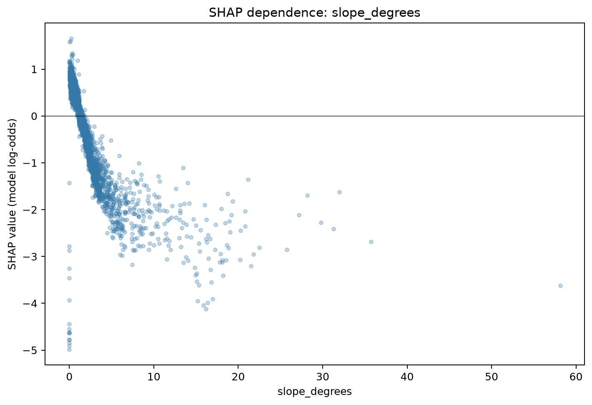

# Spatio-Temporal Urban Flood Hotspot Prediction

This Houston research project builds and evaluates models that distinguish sampled locations with a 311 flooding report from sampled locations without one. It combines report labels with terrain, drainage, land-cover, highway-proximity, and rainfall data; compares table-based models with terrain-image CNNs; and uses SHAP to explain a frozen LightGBM model. The final model setup was frozen before a one-time evaluation on Tropical Storm Imelda data.

> **Research prototype, not an official flood warning.** The label is based on reports and sampling, not measured flood depth or verified property-level flooding. Do not use model outputs instead of official warnings, engineering assessments, or flood maps.

## 1. Project summary

The completed workflow cleans and enriches Houston flood-report data, compares models using geographic and storm holdouts, freezes the selected no-rainfall model setup, evaluates it once on the reserved Imelda storm, and explains the final LightGBM model with training-only SHAP values.

## 2. Problem and label

The target is `flooded`:

- **Flooded (`1`)**: a location associated with a Houston 311 flooding report.
- **Not flooded (`0`)**: a sampled spot with no such report.

A missing report does not prove that a location did not flood. The labels describe the project’s constructed sample, not a complete inventory of observed flooding or real-world flood prevalence.

## 3. Data sources

| Data | Source and use |
|---|---|
| Flood reports and sampled no-report locations | City of Houston 311 records; used to form the training labels and location sample. |
| Elevation and terrain | **USGS 1-meter Digital Elevation Model (DEM), obtained through The National Map.** Elevation is used to derive `elevation_m`, `slope_degrees`, and the terrain images. Correction: the terrain workflow used this USGS 1-meter DEM, not the previously listed NOAA 3-meter raster. |
| Streams and bayous | USGS National Hydrography Dataset; used for `distance_to_bayou_m`. |
| Land cover | NLCD; used for `land_cover_type`. |
| Highway proximity | OpenStreetMap (OSM). `paved_pct` is really the share of the tract near major highways; it is **not** NLCD imperviousness and should not be interpreted as a general pavement percentage. |
| Rainfall | NOAA GHCN-Daily data, used in earlier model comparisons and retained in the cleaned table, but excluded from the final models. |

## 4. Data cleaning

The training cleaning log records the following row counts:

| Training step | Rows before | Rows removed | Rows after |
|---|---:|---:|---:|
| Starting training table | 85,738 | — | 85,738 |
| Remove duplicate latitude/longitude/storm rows | 85,738 | 8,863 | 76,875 |
| Keep flooded rows and developed-land non-flooded rows | 76,875 | 10,310 | 66,565 |
| Remove flooded rows outside developed land | 66,565 | 51 | 66,514 |

The final training table is `data/processed/training_clean.csv`. Its `grid_id` is used to make spatially grouped validation folds. Cleaning operations and counts are recorded in `reports/cleaning_log.csv`.

## 5. Features and rainfall decision

The final table-based models use:

- `elevation_m`
- `slope_degrees`
- `distance_to_bayou_m`
- `paved_pct`
- `land_cover_type`

`rainfall_inches` is intentionally excluded from every final model. Saved project analyses show that rainfall differs substantially across storms: Hurricane Harvey’s maximum was 20.818 inches, compared with 13.216 inches for the highest maximum among the other training storms; Imelda’s median was 1.480 inches, compared with 8.017 inches for cleaned training. These storm differences, and the inconsistent cross-storm behavior when rainfall was included, motivated leaving rainfall out. They do not prove that rainfall caused the model differences.

CNNs also use 32 × 32 relative-elevation terrain tiles. Tile values are centered on the location and scaled by the fixed 10-meter constant; missing raster pixels are filled with zero.

**Rainfall experiment:** the saved out-of-fold diagnostic shows LightGBM scores for flooded Harvey rows falling across the listed rainfall bins. This is a training-only model diagnostic; it does not establish cause and effect.



## 6. Validation and frozen setup

- **Area-group validation:** five folds grouped by `grid_id`, so grid cells are held out from the corresponding training fold.
- **Leave-one-storm-out validation:** each of the three training storms is held out in turn.
- Table preprocessing is fitted on training rows within each fold.
- Validation metrics in `reports/results.csv` use the default 0.5 classification threshold.
- Model and feature choices were frozen in `reports/final_setup.csv` and `docs/FINAL_SETUP.md`. The saved cutoffs were selected from area-fold out-of-fold predictions and then applied unchanged to the storm folds.
- Imelda was reserved for one final test after the setup was frozen. It was evaluated once; its scores were not used to change models, features, or cutoffs.

## 7. Models compared on validation folds

The following table reports the no-rainfall model variants and the terrain-only CNN. Values are mean scores from `reports/results.csv`; classification metrics use the default 0.5 threshold. ROC-AUC and PR-AUC use probabilities.

| Model | Validation | Recall | Precision | F1 | ROC-AUC | PR-AUC |
|---|---|---:|---:|---:|---:|---:|
| Logistic regression | Area groups | 0.7902 | 0.7019 | 0.7434 | 0.7809 | 0.7431 |
| Logistic regression | Leave one storm out | 0.7921 | 0.7018 | 0.7442 | 0.7814 | 0.7439 |
| Random Forest | Area groups | 0.7883 | 0.7944 | 0.7912 | 0.8658 | 0.8397 |
| Random Forest | Leave one storm out | 0.8596 | 0.8011 | 0.8293 | 0.8963 | 0.8833 |
| XGBoost | Area groups | 0.8445 | 0.7979 | 0.8205 | 0.8869 | 0.8632 |
| XGBoost | Leave one storm out | 0.8785 | 0.8017 | 0.8383 | 0.8982 | 0.8736 |
| LightGBM | Area groups | 0.8528 | 0.8012 | 0.8261 | 0.8913 | 0.8677 |
| LightGBM | Leave one storm out | 0.8843 | 0.8051 | 0.8428 | 0.9015 | 0.8772 |
| MLP | Area groups | 0.8291 | 0.7518 | 0.7884 | 0.8530 | 0.8316 |
| MLP | Leave one storm out | 0.8248 | 0.7565 | 0.7891 | 0.8541 | 0.8318 |
| CNN tile-only | Area groups | 0.7261 | 0.7057 | 0.7154 | 0.7738 | 0.7562 |
| CNN tile-only | Leave one storm out | 0.8163 | 0.6670 | 0.7337 | 0.7692 | 0.7514 |
| CNN hybrid | Area groups | 0.8318 | 0.7869 | 0.8086 | 0.8797 | 0.8641 |
| CNN hybrid | Leave one storm out | 0.8492 | 0.7781 | 0.8118 | 0.8791 | 0.8634 |

The hybrid CNN combines the terrain tile with the table features. LightGBM without rainfall had the strongest ROC-AUC among these final-model candidates on both validation designs.



**Terrain CNN experiment:** the hybrid model joins the 32 × 32 terrain image with the table features. The image-only CNN uses terrain tiles alone. Training loss decreased over the fixed training epochs; loss is not a measure of held-out performance. The example panels are training terrain tiles and illustrate relative elevation, not flood depth.





## 8. One-time final Imelda test

The following are saved results at each model’s **frozen cutoff**, from `reports/final_test_results.csv`. The experiment-only terrain CNN and dummy reference are not final models and are omitted here.

| Final model | Frozen cutoff | Recall | Precision | F1 | Accuracy | ROC-AUC | PR-AUC |
|---|---:|---:|---:|---:|---:|---:|---:|
| Logistic regression without rainfall | 0.44 | 0.8125 | 0.6631 | 0.7303 | 0.6947 | 0.7511 | 0.7168 |
| LightGBM without rainfall | 0.50 | 0.8655 | 0.7976 | 0.8302 | 0.8199 | 0.8896 | 0.8603 |
| MLP without rainfall | 0.47 | 0.8402 | 0.7403 | 0.7871 | 0.7689 | 0.8429 | 0.8121 |
| CNN hybrid without rainfall | 0.47 | 0.8459 | 0.7726 | 0.8076 | 0.7950 | 0.8746 | 0.8534 |

This is a single-storm result, not evidence that the models generalize to all future storms or locations. `reports/final_test.lock` prevents an accidental second run.



## 9. SHAP findings

Mean absolute SHAP values for the frozen LightGBM model, from `reports/shap_feature_importance.csv`:

| Rank | Feature | Mean absolute SHAP |
|---:|---|---:|
| 1 | `elevation_m` | 1.329801 |
| 2 | `paved_pct` | 0.723200 |
| 3 | `slope_degrees` | 0.653920 |
| 4 | Land cover: Developed, Low Intensity | 0.192739 |
| 5 | `distance_to_bayou_m` | 0.152670 |
| 6 | Land cover: Developed, Open Space | 0.126350 |
| 7 | Land cover: Developed, Medium Intensity | 0.067090 |
| 8 | Land cover: Developed, High Intensity | 0.058367 |

Built-in LightGBM split-count importance partly agrees with SHAP: the methods share two of their top three features. **SHAP shows what the model uses, not what causes flooding.** In particular, `paved_pct` is the share of the tract near major highways.





The following dependence plots show model contributions across the observed feature values:







## 10. Limitations

- The final evaluation uses one test storm.
- About 3,800 grid cells are shared between the Imelda sample and training, so this tests a new storm at mostly familiar places.
- A 311 report is not a direct measurement of flooding; no report is not proof of no flood.
- A 320-meter terrain tile near a 1-kilometer grid-cell border can overlap a neighboring cell, making area validation slightly less strict for CNNs than for table models.
- 3,828 training terrain pictures (5.755%) contain at least one missing or nodata pixel; those pixels are filled with zero.
- No hyperparameter search was performed. The saved cutoffs were selected from validation predictions before the final test.
- `paved_pct` describes proximity to major highways, not general imperviousness, and SHAP is not a causal analysis.

## 11. Project structure and running the notebooks

```text
data/
  raw/                         Source datasets and local elevation rasters
  processed/
    training_clean.csv         Cleaned training table
    tiles/                     Local training and test terrain arrays
src/
  data.py                      Data cleaning/loading helpers
  features.py                  Feature preparation and validation splits
  models.py                    Fixed model constructors
  evaluate.py                  Metrics and validation result saving
  tiles.py                     Raster and terrain-tile helpers
  cnn.py                       Terrain CNNs
  final_test.py                Locked, one-time final test runner
  explain.py                   Training-only LightGBM SHAP analysis
notebooks/                     Ordered analysis notebooks
reports/
  results.csv                  Saved validation metrics
  final_setup.csv              Frozen models, features, and cutoffs
  final_test_results.csv       Saved one-time test metrics
  shap_feature_importance.csv  SHAP and built-in importance comparison
docs/
  FINAL_SETUP.md               Frozen final setup details
  PROJECT_RECORD.md             Detailed project history
```

Run notebooks in order:

1. `01_data_cleaning.ipynb` — prepare the training table
2. `02_eda.ipynb` — explore the cleaned data
3. `03_splits.ipynb` — inspect features and validation splits
4. `04_baseline.ipynb` — evaluate baseline models
5. `05_tree_models.ipynb` — compare tree models
6. `06_storm_diagnosis.ipynb` — inspect storm-held-out behavior
7. `07_threshold.ipynb` — select validation-based cutoffs
8. `08_mlp.ipynb` — compare the MLP
9. `09_no_rainfall_comparison.ipynb` — compare models with and without rainfall
10. `10_cnn.ipynb` — compare terrain CNNs
11. `11_final_test.ipynb` — one-time frozen final test
12. `12_shap.ipynb` — explain the frozen LightGBM model using training rows

The final-test notebook is intentionally one-time: do not run it if `reports/final_test.lock` already exists. The SHAP notebook requires the dependencies in `requirements.txt`. Large raster and tile data are local artifacts and should remain out of Git.

## 12. Team

- Sakina Saifuddin
- Aaliyah D. McAfee
- Van Bao Nguyen

COSC 6368 · University of Houston
