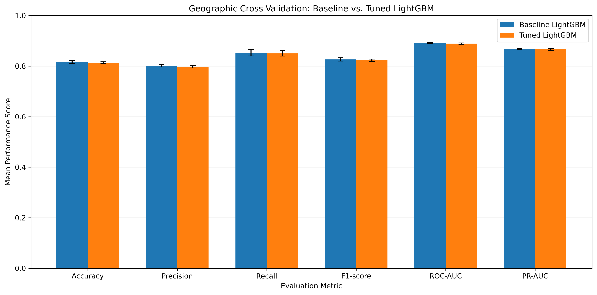
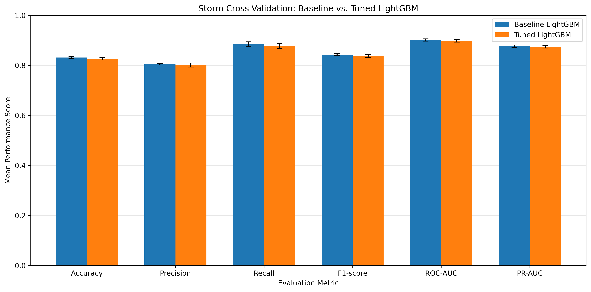
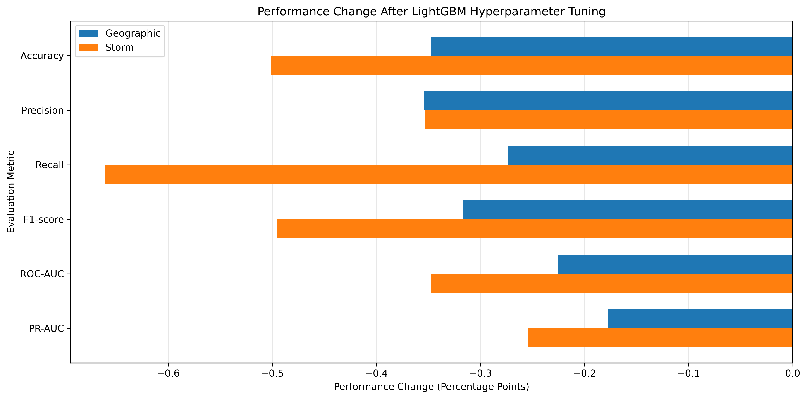
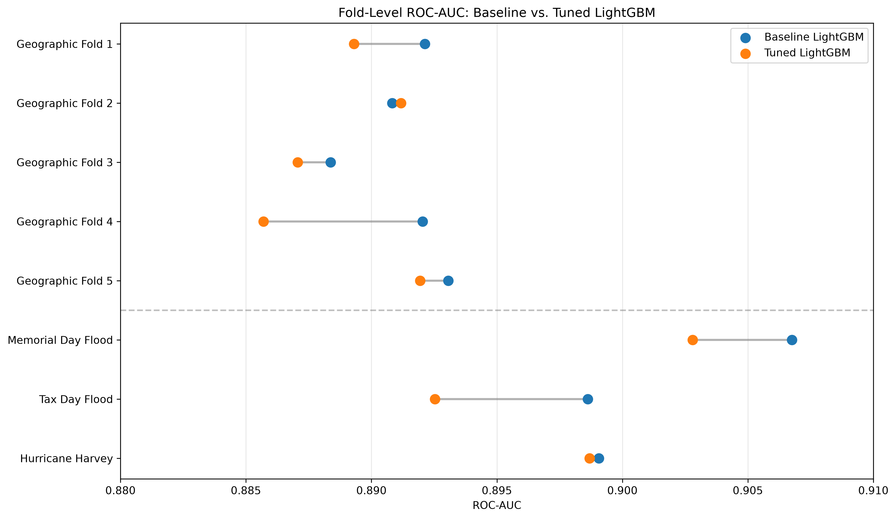

# LightGBM Hyperparameter Tuning Experiment

## 1. Experiment Objective

The objective of this experiment was to determine whether hyperparameter tuning could improve the predictive performance of the existing LightGBM model used in FloodSense.

The experiment focused primarily on improving ROC-AUC while also evaluating accuracy, precision, recall, F1-score, and PR-AUC.

To ensure a fair comparison, the original dataset, feature selection, preprocessing procedures, and outer cross-validation strategies were preserved.

## 2. Dataset and Features

The experiment used the existing cleaned training dataset:

`data/processed/training_clean.csv`

Dataset characteristics:

- Total samples: 66,514
- Positive samples: 33,955
- Negative samples: 32,559
- Unique geographic grid cells: 4,492
- Missing values: 0

The training dataset contains observations associated with three historical flood events:

| Flood Event | Samples |
|---|---:|
| Memorial Day Flood | 21,780 |
| Tax Day Flood | 21,850 |
| Hurricane Harvey | 22,884 |
| Total | 66,514 |

The following five predictive features were used:

| Feature | Description |
|---|---|
| elevation_m | Terrain elevation in meters |
| slope_degrees | Terrain slope in degrees |
| distance_to_bayou_m | Distance to the nearest bayou in meters |
| paved_pct | Census tract proportion associated with proximity to major highways |
| land_cover_type | Land cover classification |

Rainfall was excluded to remain consistent with the existing final model configuration.

The target variable was `flooded`. Positive labels represent locations associated with historical 311 reports, while negative labels represent sampled locations without associated reports. These labels are proxies for flooding rather than independently verified flood observations.

Numerical features were standardized, and categorical features were one-hot encoded using the existing preprocessing pipeline.

## 3. Baseline LightGBM Model

Before performing hyperparameter tuning, the original LightGBM model was evaluated using the existing cross-validation procedures.

The relevant baseline hyperparameters were:

| Hyperparameter | Baseline Value |
|---|---:|
| n_estimators | 300 |
| learning_rate | 0.1 |
| num_leaves | 31 |
| max_depth | -1 |
| min_child_samples | 20 |
| reg_alpha | 0 |
| reg_lambda | 0 |
| random_state | 42 |

The original reported baseline performance was successfully reproduced for both geographic and storm-based cross-validation.

## 4. Hyperparameter Search Strategy

RandomizedSearchCV from scikit-learn was used to evaluate different LightGBM hyperparameter configurations.

Seven hyperparameters were included in the search:

| Hyperparameter | Candidate Values |
|---|---|
| n_estimators | 100, 200, 300, 500 |
| learning_rate | 0.01, 0.05, 0.1 |
| num_leaves | 15, 31, 63 |
| max_depth | 5, 10, -1 |
| min_child_samples | 20, 50, 100 |
| reg_alpha | 0, 0.1, 1 |
| reg_lambda | 0, 0.1, 1 |

These candidate values produced 2,916 possible parameter combinations.

Rather than exhaustively evaluating every combination, randomized search evaluated 20 configurations per outer fold.

### Search Settings

| Setting | Value |
|---|---|
| Search method | RandomizedSearchCV |
| Configurations per search | 20 |
| Optimization metric | ROC-AUC |
| Random seed | 42 |
| Classification threshold | 0.5 |
| Search-level parallel jobs | 1 |
| Refit best estimator | True |
| Return training scores | True |

Search-level parallelization was limited to one job because LightGBM already utilized internal parallelization.

The search space included parameters controlling model complexity, learning behavior, and regularization.

## 5. Nested Cross-Validation Methodology

Nested cross-validation was used to reduce the risk of obtaining optimistically biased performance estimates during hyperparameter selection.

The inner cross-validation loop selected the hyperparameter configuration with the highest mean ROC-AUC.

The selected configuration was then refitted using the complete outer training partition and evaluated on the corresponding outer validation partition.

The outer validation data was not used during hyperparameter selection.

Preprocessing was included within the model pipeline so that preprocessing transformations were fitted using the appropriate training partition.

### 5.1 Geographic Cross-Validation

Geographic cross-validation evaluated the ability of the model to generalize to unseen geographic grid cells.

- Outer validation folds: 5
- Inner validation folds: 4
- Grouping variable: grid_id
- Geographic grid overlap between training and validation partitions: 0

GroupKFold was used to ensure that samples associated with the same geographic grid cell were not divided between training and validation partitions within a fold.

The geographic experiment required:

5 outer folds x 4 inner folds x 20 configurations = 400 search fits.

Including the five refitted estimators, a total of 405 model fits were performed.

### 5.2 Storm-Based Cross-Validation

Storm-based cross-validation evaluated the ability of the model to generalize to historical flood events that were excluded from training.

- Outer validation folds: 3
- Inner validation folds: 2
- Validation strategy: Leave-one-storm-out

Each outer iteration held out one complete storm for validation.

The remaining two storms were used for inner cross-validation and hyperparameter selection.

Geographic grid overlap between different storms was permitted to remain consistent with the original evaluation procedure.

The storm-based experiment required:

3 outer folds x 2 inner folds x 20 configurations = 120 search fits.

Including the three refitted estimators, a total of 123 model fits were performed.

### 5.3 Computational Cost

| Validation Strategy | Search Fits | Refit Models | Total Fits |
|---|---:|---:|---:|
| Geographic | 400 | 5 | 405 |
| Storm-based | 120 | 3 | 123 |
| Total | 520 | 8 | 528 |

The combined hyperparameter search and refitting runtime was approximately 11.87 minutes.

This runtime is hardware-dependent and does not include baseline evaluation or subsequent analysis.

## 6. Experimental Results

All reported performance values represent mean outer cross-validation scores.

### 6.1 Geographic Cross-Validation Results

| Metric | Baseline | Tuned | Difference |
|---|---:|---:|---:|
| Accuracy | 0.816806 | 0.813333 | -0.003473 |
| Precision | 0.801182 | 0.797641 | -0.003541 |
| Recall | 0.852761 | 0.850028 | -0.002734 |
| F1-score | 0.826129 | 0.822962 | -0.003167 |
| ROC-AUC | 0.891287 | 0.889035 | -0.002252 |
| PR-AUC | 0.867742 | 0.865970 | -0.001772 |

The tuned model did not improve any of the six average geographic cross-validation metrics.

ROC-AUC decreased by approximately 0.225 percentage points, while recall decreased by approximately 0.273 percentage points.

### 6.2 Storm-Based Cross-Validation Results

| Metric | Baseline | Tuned | Difference |
|---|---:|---:|---:|
| Accuracy | 0.831657 | 0.826640 | -0.005017 |
| Precision | 0.805087 | 0.801551 | -0.003537 |
| Recall | 0.884294 | 0.877686 | -0.006608 |
| F1-score | 0.842806 | 0.837848 | -0.004958 |
| ROC-AUC | 0.901477 | 0.898005 | -0.003472 |
| PR-AUC | 0.877192 | 0.874650 | -0.002542 |

The tuned model did not improve any of the six average storm-based cross-validation metrics.

ROC-AUC decreased by approximately 0.347 percentage points, while recall decreased by approximately 0.661 percentage points.

### 6.3 Overall Performance Changes

Across both validation strategies, none of the twelve aggregate metric comparisons improved following hyperparameter tuning.

The original LightGBM configuration achieved higher average performance for every evaluated metric.

### 6.4 Fold-Level ROC-AUC Comparison

| Validation Fold | Baseline | Tuned | Difference |
|---|---:|---:|---:|
| Geographic Fold 1 | 0.892127 | 0.889305 | -0.002822 |
| Geographic Fold 2 | 0.890831 | 0.891178 | +0.000347 |
| Geographic Fold 3 | 0.888378 | 0.887062 | -0.001315 |
| Geographic Fold 4 | 0.892043 | 0.885695 | -0.006348 |
| Geographic Fold 5 | 0.893056 | 0.891934 | -0.001122 |
| Memorial Day Flood | 0.906751 | 0.902793 | -0.003958 |
| Tax Day Flood | 0.898621 | 0.892535 | -0.006087 |
| Hurricane Harvey | 0.899057 | 0.898686 | -0.000372 |

Only one of the eight outer validation folds demonstrated an improvement in ROC-AUC.

The improvement occurred in Geographic Fold 2 and was relatively small.

## 7. Selected Hyperparameter Configurations

Three unique hyperparameter configurations were selected across the eight outer validation folds.

| Hyperparameter | Configuration A | Configuration B | Configuration C |
|---|---:|---:|---:|
| n_estimators | 500 | 300 | 300 |
| learning_rate | 0.1 | 0.05 | 0.05 |
| num_leaves | 15 | 31 | 63 |
| max_depth | 5 | -1 | 10 |
| min_child_samples | 50 | 20 | 50 |
| reg_alpha | 0 | 0 | 1 |
| reg_lambda | 1 | 1 | 0 |
| Selection count | 5 | 2 | 1 |
| Selection percentage | 62.5% | 25.0% | 12.5% |

Configuration A was selected most frequently, appearing in five of the eight outer validation folds.

Compared with the original LightGBM configuration, Configuration A used:

- More boosting iterations.
- Fewer maximum leaves.
- A restricted maximum tree depth.
- More minimum samples per leaf.
- Additional L2 regularization.

All eight selected configurations incorporated either L1 or L2 regularization.

However, the frequency with which these configurations were selected during inner cross-validation did not translate into improved average outer validation performance.

## 8. Discussion

The experimental results indicate that the original LightGBM configuration performed effectively on the existing FloodSense training dataset.

Although randomized search identified configurations with favorable inner validation performance, these configurations did not consistently outperform the original model on the outer validation partitions.

The results demonstrate that hyperparameter tuning does not guarantee improved generalization.

The declines in performance were relatively small, suggesting that the evaluated configurations achieved broadly comparable performance.

However, because the original configuration achieved higher average performance across both validation strategies, replacing it with the tuned configurations is not supported by the results of this experiment.

## 9. Experimental Limitations

The following limitations should be considered when interpreting the results:

1. Only 20 of the 2,916 possible hyperparameter combinations were evaluated per randomized search.

2. The original LightGBM configuration was not explicitly guaranteed to appear among the randomly sampled configurations.

3. The storm-based experiment included only three historical training flood events. Each inner storm validation iteration trained on a single event.

4. Storm-based cross-validation permitted geographic overlap between training and validation events. It therefore primarily evaluated generalization across storms rather than generalization to entirely unseen geographic locations.

5. Geographic cross-validation prevented shared grid cells but did not guarantee a minimum spatial separation between training and validation locations.

6. The search optimized ROC-AUC rather than recall, precision, or other classification metrics directly.

7. Statistical significance testing was not performed. The observed differences should not be interpreted as statistically significant improvements or declines.

8. The experiment used 311-based proxy labels rather than independently verified flood observations.

9. The held-out Imelda test set was not accessed or reevaluated during this experiment.

10. The finalized notebook's known directory initialization ordering issue was corrected, but a complete fresh-kernel execution was not performed after this correction.

The experiment does not establish that the baseline model is globally optimal. It establishes that the particular randomized hyperparameter search performed here did not improve its average outer cross-validation performance.

## 10. Final Model Recommendation

Retain the original LightGBM configuration for the FloodSense application.

The original model achieved higher average accuracy, precision, recall, F1-score, ROC-AUC, and PR-AUC under both geographic and storm-based cross-validation.

The existing final model selection, frozen configuration, and held-out test results should remain unchanged.

Potential future improvements could investigate broader hyperparameter search spaces, alternative optimization objectives, additional historical flood events, and improved feature engineering.

## 11. Experimental Artifacts

The complete implementation is available in:

`notebooks/13_hyperparameter_tuning.ipynb`

Experimental outputs are stored separately in:

`reports/hyperparameter_tuning/`

### Performance Results

- baseline_area_results.csv
- baseline_storm_results.csv
- tuned_area_results.csv
- tuned_storm_results.csv
- tuned_area_summary.csv
- tuned_storm_summary.csv
- area_comparison.csv
- storm_comparison.csv
- overall_comparison.csv
- fold_comparison.csv

### Hyperparameter Results

- selected_area_params.csv
- selected_storm_params.csv
- all_selected_params.csv
- configuration_frequency.csv

### Out-of-Fold Predictions

- tuned_area_oof.csv
- tuned_storm_oof.csv

Each prediction file contains 66,514 records.

All predictions were checked for complete row coverage, duplicate row indexes, missing values, valid probability ranges, correct target labels, and correct validation fold assignments.

Storm-based predictions were additionally checked for correct storm names.

### Visualizations

- figures/geographic_performance.png
- figures/storm_performance.png
- figures/performance_difference.png
- figures/fold_roc_auc_comparison.png

All visualizations were exported as PNG files at 300 DPI.

## 12. Reproduction Instructions

The experiment was conducted using Python 3.11.0 within a virtual environment.

The main package versions used were:

| Package | Version |
|---|---|
| NumPy | 2.4.6 |
| pandas | 3.1.1 |
| SciPy | 1.17.1 |
| scikit-learn | 1.9.1 |
| Matplotlib | 3.11.2 |
| LightGBM | 4.7.0 |
| XGBoost | 3.2.0 |
| PyTorch | 2.15.0+cpu |

XGBoost and PyTorch were installed to support imports from the existing project implementation. They were not independently tuned during this experiment.

To reproduce the experiment:

1. Obtain the repository containing the hyperparameter tuning notebook.
2. Create and activate a Python 3.11 virtual environment.
3. Install the required Python packages and Jupyter Notebook.
4. Confirm that data/processed/training_clean.csv exists.
5. Launch Jupyter Notebook from the project root directory.
6. Open notebooks/13_hyperparameter_tuning.ipynb.
7. Select the kernel associated with the project virtual environment.
8. Execute the notebook sequentially.

The notebook reproduces the baseline results, performs nested hyperparameter searches, evaluates model performance, generates visualizations, and exports the experimental results.

The existing Imelda final test notebook does not need to be executed.

## 13. Contribution Summary

This contribution extended the existing FloodSense machine learning evaluation by:

- Reproducing the original LightGBM baseline.
- Designing a seven-parameter randomized search space.
- Implementing nested geographic cross-validation.
- Implementing nested storm-based cross-validation.
- Performing 528 hyperparameter search and refitting model fits.
- Evaluating six performance metrics.
- Analyzing selected hyperparameter configurations.
- Generating and validating 133,028 out-of-fold predictions.
- Creating four performance comparison visualizations.
- Exporting sixteen experimental CSV files.
- Providing a reproducible experiment notebook and standalone documentation.

The experiment provided additional empirical support for retaining the existing LightGBM model configuration within the scope of the evaluated search.
